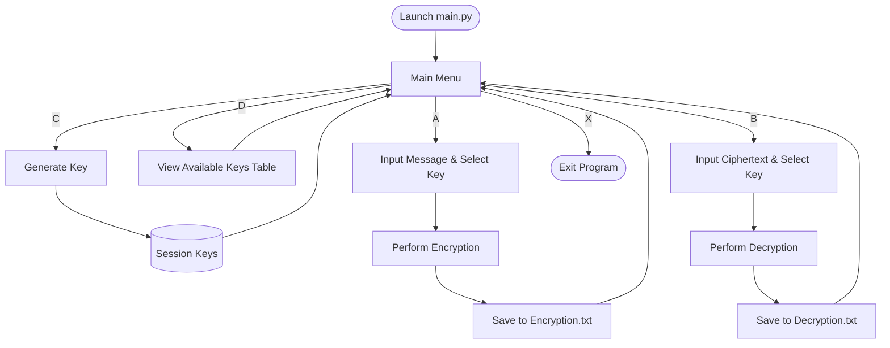

# Enigma Machine (Monoalphabetic Cipher CLI)

A rich terminal-based cryptography application implemented in Python. The program simulates custom monoalphabetic substitution ciphers with interactive key generation, encryption, decryption, and automatic operation logging with styled command-line visuals powered by the [Rich](https://github.com/Textualize/rich) library.

---

## Table of Contents

- [Overview](#overview)
- [Key Features](#key-features)
- [Project Architecture](#project-architecture)
- [Prerequisites](#prerequisites)
- [Installation & Setup](#installation--setup)
- [Usage & Running Process](#usage--running-process)
  - [Step-by-Step Walkthrough](#step-by-step-walkthrough)
  - [Main Menu Options](#main-menu-options)
- [Generated Artifacts & Logs](#generated-artifacts--logs)
- [Cipher Logic Explained](#cipher-logic-explained)
- [Notes & Considerations](#notes--considerations)

---

## Overview

The **Enigma Machine** project provides an interactive CLI for encrypting and decrypting text using randomized monoalphabetic substitution. Each generated key defines a distinct 1-to-1 character mapping for both lowercase (`a-z`) and uppercase (`A-Z`) English letters. 

The application provides real-time visual feedback via animated progress bars, formatted key inspection tables, and color-coded status messages. Every encryption and decryption run is automatically logged with exact timestamps and substitution mappings to persistent text files.

---

## Key Features

- **Interactive Terminal UI**: Built with `rich` to provide formatted menus, ASCII tables, styled text, and progress animations.
- **Randomized Key Generation**: Shuffles standard 52-character alphabets (lowercase and uppercase) to create unique substitution dictionaries.
- **Bi-directional Cipher Engine**:
  - **Encryption**: Translates plain text into ciphertext according to the selected substitution key.
  - **Decryption**: Reverses substitution mapping to restore the original message.
- **Persistent Audit Logging**: Appends timestamped execution logs with message content, key IDs, and character mapping tables to `Encryption.txt` and `Decryption.txt`.
- **Session Key Management**: Holds and indexes multiple keys simultaneously during a runtime session.

---

## Project Architecture

The codebase is organized into modular components:

```
Enigma Machine/
├── main.py                   # Application entry point & main menu execution loop
├── menu_module.py            # Menu class, UI workflows, input validation & dispatchers
├── key_module.py             # Key generation, storage dictionary & tabular display
├── monoalphabetic_cipher.py  # MonoalphabeticCipher core engine & file logging
├── utilities_module.py       # Terminal helper functions (clearing, progress bars, delays)
├── mesage_encryptor.py       # Message data stub
├── requirements.txt          # Python dependencies
├── .gitignore                # Ignored cache, virtualenv, and log files
└── README.md                 # Project documentation
```

### Module Breakdown

| Module | Primary Responsibility |
|---|---|
| `main.py` | Initializes menu options (`[A]`, `[B]`, `[C]`, `[D]`, `[X]`) and hosts the primary interactive event loop. |
| `menu_module.py` | Encapsulates the `Menu` class, handles user code verification, orchestrates input prompts, and routes requests to the cipher engine. |
| `key_module.py` | Manages the in-memory session key store (`keys`), generates randomized 52-character substitution pairs, and renders the ASCII key table. |
| `monoalphabetic_cipher.py` | Implements `MonoalphabeticCipher` containing character-by-character transformation logic and timestamped file recording (`_save_to_file`). |
| `utilities_module.py` | Provides cross-platform terminal utilities (`cls` / `clear`), simulated progress spinners, and prompt pauses. |

---

## Prerequisites

- **Python**: Version `3.10` or higher (required for modern union typing such as `str | None` and built-in generic collections `list[Menu]`).
- **Operating System**: Windows, macOS, or Linux.
- **Terminal**: Modern terminal with ANSI color support (e.g., Windows Terminal, PowerShell, Bash, Zsh).

---

## Installation & Setup

1. **Clone or Navigate to the Repository**:
   ```bash
   cd "Enigma Machine"
   ```

2. **(Optional) Create and Activate a Virtual Environment**:
   - **Windows (PowerShell)**:
     ```powershell
     python -m venv .venv
     .venv\Scripts\Activate.ps1
     ```
   - **macOS / Linux**:
     ```bash
     python3 -m venv .venv
     source .venv/bin/activate
     ```

3. **Install Dependencies**:
   ```bash
   pip install -r requirements.txt
   ```

---

## Usage & Running Process

To start the Enigma Machine, execute `main.py` with your Python interpreter:

```bash
python main.py
```

### Main Menu Options

When launched, the program displays the main control menu:

```text
               ENIGMA MACHINE
[A] - Encrypt Message
[B] - Decrypt Message
[C] - Generate Key
[D] - Show Available Keys
[X] - Exit
Enter the code of the option you want to select:
```

### Step-by-Step Walkthrough



#### 1. Generate a Key (`[C]`)
- Because keys are created in memory for the active session, generate at least one key before encrypting or decrypting.
- Select `C`. The system shuffles characters and registers a new numeric key (e.g., `Key 1`, `Key 2`).

#### 2. View Available Keys (`[D]`)
- Select `D` to display an ASCII table listing all generated keys in the current session.

#### 3. Encrypt a Message (`[A]`)
- Select `A`.
- Enter the plain text message when prompted (e.g., `Hello World`).
- Enter the target key number (e.g., `1`).
- The program processes the text, strips whitespace, outputs the character substitution breakdown, and prints the resulting ciphertext.
- The result is automatically logged to `Encryption.txt`.

#### 4. Decrypt a Message (`[B]`)
- Select `B`.
- Enter the ciphertext (e.g., output received from step 3).
- Select the identical key number used during encryption.
- The inverse substitution mapping will be applied to display the reconstructed plain text.
- The result is automatically logged to `Decryption.txt`.

#### 5. Exit (`[X]`)
- Select `X` to cleanly exit the application.

---

## Generated Artifacts & Logs

During encryption and decryption, the application automatically maintains two audit log files in the project root:

- **`Encryption.txt`**: Logs every encryption event.
- **`Decryption.txt`**: Logs every decryption event.

### Log Entry Format Sample
```text
------------------------------------------------------------------------------------------------------------------------
Monday, October 14 2026 at 02:30 AM

Message: HelloWorld
Key Number: 1

Original Text: a b c d e f g h i j k l m n o p q r s t u v w x y z A B C D E F G H I J K L M N O P Q R S T U V W X Y Z
Replaced With: x y z a b c d e f g h i j k l m n o p q r s t u v w X Y Z A B C D E F G H I J K L M N O P Q R S T U V W

Encryption Message: EbiilTloia
------------------------------------------------------------------------------------------------------------------------
```

---

## Cipher Logic Explained

The cipher uses a **monoalphabetic substitution** technique:
1. Two 26-character pools are combined: lowercase `a` to `z` (ASCII 97–122) and uppercase `A` to `Z` (ASCII 65–90), totaling 52 distinct alphabet characters.
2. The 52 characters are shuffled randomly using `random.shuffle()`.
3. A dictionary mapping each standard character to a randomized substitute character is built:
   $$\text{Letter} \mapsto \text{Substitute Letter}$$
4. Whitespace characters are stripped before transformation (`"".join(message.split())`).
5. Decryption locates the cipher character in `key.values()` and retrieves the corresponding character in `key.keys()`.

---

## Notes & Considerations

- **Session Persistence**: Currently, keys are held in memory within the active Python session. Terminating the program clears active keys from memory; make sure to reference the character mappings stored in `Encryption.txt` if re-entering ciphertexts across separate sessions.
- **Special Characters & Numbers**: The substitution dictionary is configured for standard Latin alphabetic characters (`a-z`, `A-Z`). Inputting punctuation or numbers that are not in the key may result in a key lookup error.
